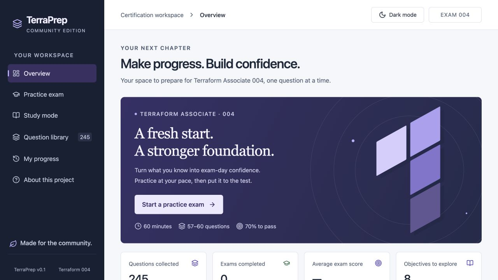

# TerraPrep Community

A free, local-first practice app for **Terraform Associate 004**. Runs in one
Docker container with SQLite. No account, API key, or cloud service required.



## Quick start

With Docker Desktop running, open a terminal in this repository and run:

```sh
docker compose up --build -d
```

Open **[http://localhost:8080](http://localhost:8080)**.

- **Practice exams:** 57–60 questions, 60 minutes, 70% passing target.
- **Study mode:** topic filters, missed-question practice, and explanations.
- **Question library:** 245 collected entries, including 212 unique questions
  ready for practice. Duplicates and entries needing review stay searchable.
- **Progress:** saved answers, review flags, exam history, and objective scores.
- Light/dark themes and syntax-highlighted Terraform code.

## Progress and configuration

Progress stays in the `terraprep-data` Docker volume. Stop the app with
`docker compose down`; adding `-v` deletes that data.

History is tied to your browser cookie. Use the same browser and address:
`localhost` and `127.0.0.1` have separate histories.

Copy [.env.example](.env.example) to `.env` to change the port or hosting settings.
The default is local access only. Free public hosting is supported; set
`SOURCE_URL` to the corresponding source repository and use HTTPS.

## Development

Requires Node.js 24+.

```sh
npm ci
npm run dev
```

Open [http://localhost:5173](http://localhost:5173). See
[CONTRIBUTING.md](CONTRIBUTING.md) for checks and demo data, and
[questions/README.md](questions/README.md) for question-bank updates.

## License

Free noncommercial use and free hosting under the custom
[TerraPrep Community License 1.0](LICENSE), with source-sharing requirements. Third-party
content keeps its own terms; see [THIRD_PARTY_NOTICES.md](THIRD_PARTY_NOTICES.md).

Independent of HashiCorp. Exam timing, question count, and passing threshold are
practice simulator settings.
